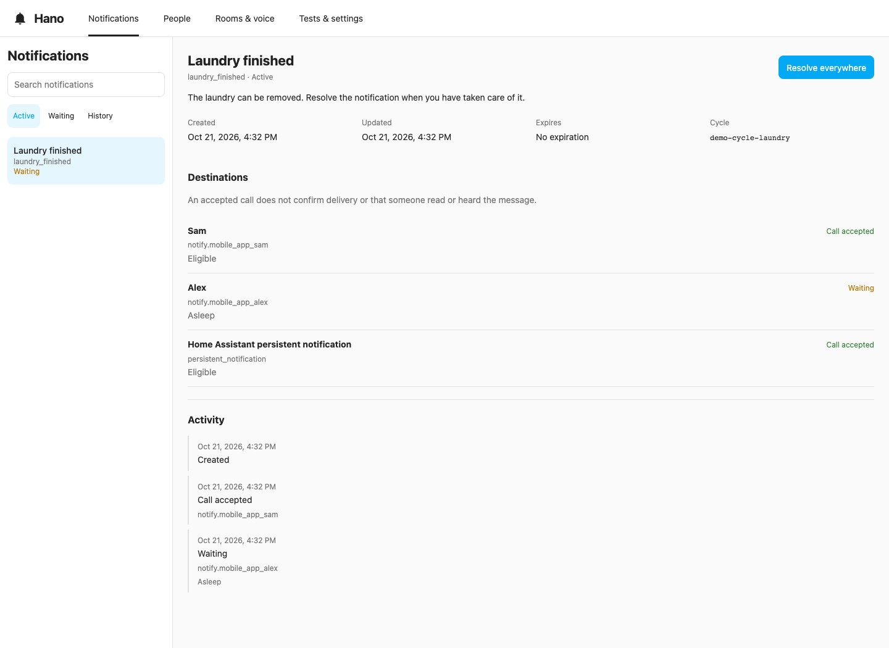
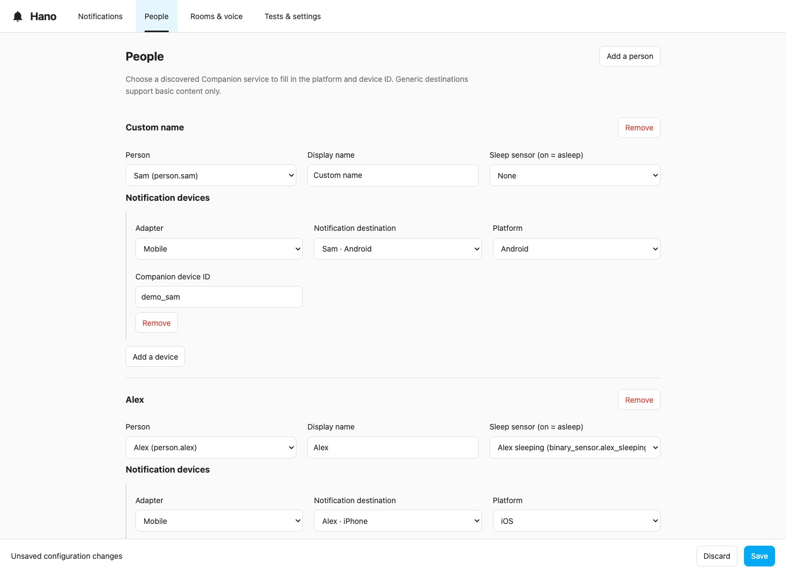
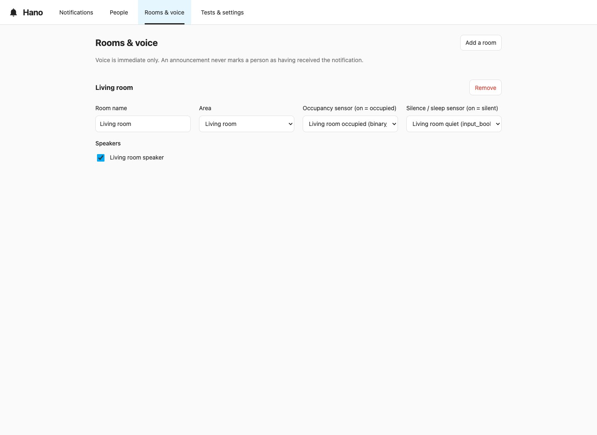

<div align="center">
  
  <h1>Hano</h1>
  <p><strong>Home Assistant Notification Orchestrator</strong></p>
  <p>Send once. Wait for each person. Resolve everywhere.</p>
</div>

[](https://github.com/Gnol86/Hano/actions/workflows/validate.yml)
[](https://github.com/Gnol86/Hano/actions/workflows/hacs.yml)
[](https://github.com/Gnol86/Hano/releases)
[](LICENSE)

Hano is a native Home Assistant integration for mobile notifications, immediate
voice announcements, and Home Assistant persistent notifications. Automations
choose the trigger, message, recipients, and options. Hano tracks each destination,
waits when requested, and closes the notification across its supported channels.
There are no notification profiles to maintain.

**Current beta: `0.1.0b2`. Requires Home Assistant 2026.10 or newer.**
Hano can be installed through a HACS custom repository; it is not listed in the
HACS default catalogue. This release does not install itself, migrate existing
automations, or stop an AppDaemon application.

## A notification that waits for the right person

The washing machine finishes. Sam is home and awake; Alex is asleep. An automation
sends a notification to present residents with **Wait individually until available**.
Sam receives it now. Alex remains pending. If Sam resolves it first, Alex is never
notified. Otherwise, Hano sends to Alex after waking up, provided Alex is home.



*Screenshots use fictional residents in the standalone demonstration. Calls are
simulated; they do not show delivery to real devices.*

## What Hano provides

- **Native actions:** `hano.send`, `hano.preview`, and `hano.resolve`, with graphical
  fields in Home Assistant's automation editor.
- **Individual availability:** selected residents, all residents, people at home,
  people away, or the nearest eligible people. Sleep is independent of priority.
- **One lifecycle:** update an active notification without replaying its voice
  announcement; start a new cycle explicitly when it is time to notify again.
- **Your buttons:** free labels, links, or Home Assistant action sequences, with
  optional resolution after successful actions. No predefined buttons.
- **Persistent state:** active notifications, pending recipients, expiration, and
  history survive Home Assistant restarts. Interrupted sends are reported as
  uncertain instead of blindly repeated.
- **Immediate voice:** chosen speakers or occupied rooms, using an existing TTS
  integration. Announcements do not mark a person as having heard the message.
- **An administrator panel:** notifications, people, rooms, tests, and settings;
  English, French, and Spanish; Home Assistant light and dark themes.

Hano has no dependency on AppDaemon, Hapo, or `proximity` entities. Nearest-person
routing uses `person` coordinates and your Home Assistant home location. Existing
notification and TTS integrations still perform delivery; Hano does not introduce
another push service.

## Install

1. In HACS, open **Custom repositories** and add
   `https://github.com/Gnol86/Hano` with the **Integration** category.
2. Open Hano's download dialog and enable visibility of prerelease/beta versions.
   Select **`0.1.0b2`** and download it.
3. Restart Home Assistant to load the integration files.
4. Go to **Settings → Devices & services → Add integration**, search for **Hano**,
   and confirm setup.
5. Open **Hano** in the sidebar as an administrator.

For a manual installation, copy `custom_components/hano` from the release into
Home Assistant's `config/custom_components/hano`, then follow steps 3–5. Do not
mix manual files and a HACS-managed copy when updating.

## Configure

In **People**, add your existing `person` entities and choose each person's
Companion device or supported `notify` entity. A discovered Companion service fills
in its platform and device ID. Optionally select a `binary_sensor` or
`input_boolean` for sleep: **`on` means asleep**, **`off` means awake**. Unknown or
unavailable sleep states do not count as confirmed wakefulness.



In **Rooms & voice**, associate speakers with occupancy and optional silence/sleep
sensors. Occupancy **`on` means occupied**; silence/sleep **`on` blocks announcements**
when sleep is respected. Choose a default TTS entity in **Tests & settings**.



Save the configuration before testing. Use **Preview without sending** to inspect
routing; **Send real test** calls the selected destinations. These are distinct
actions. Configuration changes affect new cycles; an active cycle retains its
original configuration and destination mapping.

## First automation

In Home Assistant's automation editor, add **Hano: Send notification**. Set a
message, select **Present residents**, choose **Wait individually until available**,
and keep **Respect sleep** enabled. Give the notification a stable ID such as
`laundry_finished` so another automation or a button can resolve it.

Equivalent YAML, using fictional entities:

```yaml
actions:
  - action: hano.send
    data:
      notification_id: laundry_finished
      title: Laundry finished
      message: The laundry can be removed.
      recipient_mode: present
      channels:
        - mobile
        - persistent
      respect_sleep: true
      delivery: when_available
      buttons:
        - id: taken_care_of
          label: Taken care of
          actions: []
          resolve: true
```

Resolve that notification from another automation when the task is complete:

```yaml
actions:
  - action: hano.resolve
    data:
      notification_id: laundry_finished
```

Read the [action reference](docs/actions.md) for every field, response data,
buttons, updates, voice, and platform capabilities. Read the
[migration guide](docs/migration.md) before replacing an existing Notifier setup.

## What the status means

**Call accepted** means the downstream Home Assistant action returned successfully.
It does not prove receipt, reading, or hearing. Where Companion provides a
correlated device event, Hano can record receipt or clearing separately.

Resolution cancels pending sends and requests remote clearing on supported mobile
destinations. It cannot erase a spoken announcement or recall messages from a
generic notification provider. A mobile swipe remains local unless you enable
**Resolve globally when mobile clearing is reported** and the app reports a
correlatable event. Remote clearing and notification replacement depend on the
mobile platform and device permissions.

Android allows at most three buttons. Display timeout is Android-only. Camera attachments use a live attachment on iOS
and a snapshot on Android. Icons and colors are supported on both platforms with
platform-specific requirements; on iOS, an icon needs a title, and a color needs
both. Unsupported combinations fail explicitly. Critical priority does not bypass Hano's sleep
setting or guarantee that a device will sound an alert.

Voice is immediate only. There are no automatic reminders, retries of failed sends,
or escalation rules; keep those triggers in your automations. Per-announcement
volume is limited to Sonos players explicitly marked as verified in Hano and uses
the native announcement API. Hano does not temporarily change player volume and
restore it on a timer.

## Privacy and project status

The panel, history, and interactive actions require administrator access. Standard
Home Assistant automations can invoke Hano. History is kept for **30 days** by
default; active notifications remain until resolved or expired. Administrators can
purge completed history. Diagnostic exports omit messages, positions, entity
identifiers, device identities, and action content.

Stored notification state includes message content and configured button actions.
Treat Home Assistant's local storage and backups accordingly. Hano makes no direct
cloud calls; the privacy characteristics of your selected notification and TTS
providers still apply.

The beta is intended for deliberate testing before replacing existing workflows.
The repository contains automated tests, a standalone simulated panel, and local
Home Assistant validation tools. Passing software checks or publishing a release
does not establish reliability on your own phones or speakers.

- [Action reference](docs/actions.md)
- [Architecture](docs/architecture.md)
- [Migration guide](docs/migration.md)
- [Development and validation](docs/development.md)
- [Release notes](releases/0.1.0b2.md)
- [Contributing](CONTRIBUTING.md)

Hano follows the interface conventions of [Halo](https://github.com/Gnol86/Halo),
[Havo](https://github.com/Gnol86/Havo), and [Hapo](https://github.com/Gnol86/Hapo), while
remaining an independent integration.

MIT licensed. See [LICENSE](LICENSE).
